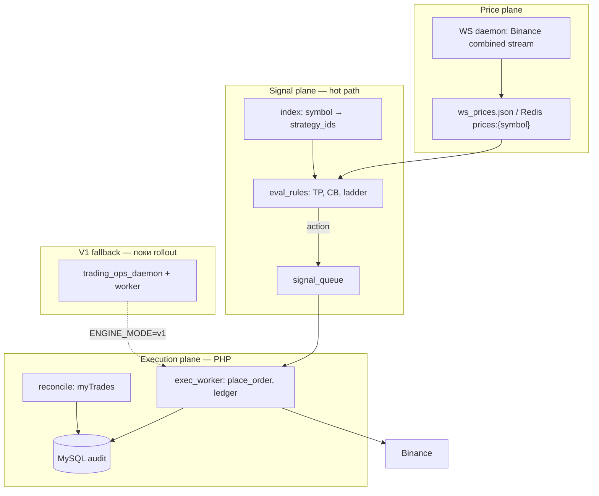

# StrIM — Architecture V2 (RoyalQ-модель, event-driven)

**Версія:** 1.0  
**Дата:** 2026-05-19  
**Статус:** план впровадження (поступово, без зупинки торгівлі)

Пов’язано: `docs/SCALING_ROADMAP.md` (етапи 0–3 поточної системи), `NEW_CHAT_HANDOFF.md` (операції), `run/V2_ROLLOUT_GATE.md` (бекап → деплой → перевірка).

---

## 1. Ціль і нові SLO

### 1.1. Проблема V1 (зараз)

- Одиниця навантаження = **стратегія × повний тік** (`process_strategy` + MySQL queue).
- Lag росте **лінійно** від кількості running (див. модель 120×5).
- RoyalQ / аналоги масштабують **символ × подія ціни**, не «600 PHP-тіків/с».

### 1.2. Ціль V2

| Метрика | V1 (зараз) | V2 (ціль) |
|---------|------------|-----------|
| **Price freshness** (`price_age_sec`) | не вимірюється стабільно | **p95 ≤ 1 с** для всіх running-символів |
| **Signal latency** (ціна → рішення «треба SELL/BUY») | = tick lag (10 с–хв) | **≤ 1 с** (eval у пам’яті) |
| **Order enqueue** | у тому ж тіку | **≤ 200 ms** після сигналу |
| **Full reconcile** (`sync_from_trades`) | кожен тік / light-full | **після угоди** + раз на 60 с |
| **Tick lag** (`last_tick_at`) | головний KPI | вторинний; замінюється на price + signal |

> **Важливо:** «≤ 1 с незалежно від кількості user» стосується **моніторингу ціни та перевірки правил**, не 10 000 повних PHP-тіків/с. Ордер на Binance залишається обмежений API key / IP.

### 1.3. Принцип міграції (strangler fig)

```
[V1 poll tick]  ──────────────────────────►  лишається DEFAULT
       │
       ├── shadow V2 eval (логи, без угод)
       ├── hybrid (ціна з WS, угоди V1)
       └── live V2 (сигнал → exec queue, V1 вимкнено для sid)
```

**Жоден крок не вимикає V1 без feature flag.** Rollback = env + redeploy попереднього бекапу.

---

## 2. Цільова архітектура (кінцевий стан)



### 2.1. Три площини

| Площина | Відповідальність | Технологія (етапи) |
|---------|------------------|---------------------|
| **Price** | Один потік на символ; `price`, `ts` | Python `ws_price_cache` → JSON; далі Redis |
| **Signal** | На оновленні ціни — eval усіх sid на символі | PHP pure functions → PHP daemon → опційно Go |
| **Execution** | Ордери, sync, journal, TG | Існуючий `engine_logic` / workers |

### 2.2. Майбутня структура файлів (орієнтир)

```
services/ws/              # price daemon (Python)
engine/
  engine_logic.php        # V1 + поступово execution-only
  engine_helpers.php
  signal/                 # NEW
    eval_strategy.php     # правила без Binance
    symbol_index.php      # symbol → [sid]
  execution/              # NEW (винесення з logic)
    handle_signal.php     # BUY/SELL по команді
engine_v2/
  signal_daemon.php       # NEW: loop price change → eval → push signal
  signal_queue.php        # NEW: MySQL або Redis
  exec_worker.php         # NEW: окремо від poll worker
www/api/
  health.php              # + price_age, engine_mode
run/
  deploy_trading_ops.sh
  deploy_v2_signal.sh     # NEW
  V2_ROLLOUT_GATE.md
```

Папки `signal/` і `execution/` створюємо **лише коли дійшли до відповідного кроку** — не все одразу.

---

## 3. Feature flags (контракт)

Додавати в `.env` / `app_settings` (перевірка на кожному кроці):

| Ключ | Значення | Ефект |
|------|----------|--------|
| `ENGINE_MODE` | `v1` (default) | Лише поточний poll tick |
| `ENGINE_MODE` | `shadow` | V1 торгує; V2 eval лише лог |
| `ENGINE_MODE` | `hybrid` | Ціна з WS; угоди ще V1 |
| `ENGINE_MODE` | `v2` | Сигнали V2; V1 poll вимкнено для running |
| `SIGNAL_ENGINE_ENABLED` | `0`/`1` | Master kill switch |
| `PRICE_MAX_AGE_SEC` | `2` | Watchdog / health warn |
| `V2_CANARY_STRATEGY_IDS` | `22,15` | Лише ці sid на V2 live |

**Правило:** новий код за замовчуванням **вимкнений** (`ENGINE_MODE=v1`).

---

## 4. План по фазах (поступово)

Кожна фаза = **1–3 PR / деплої**. Між фазами — стабільний прод мінімум 24–48 год.

### Фаза 0 — Документація і процес (без змін торгівлі)

| # | Дія | Ризик |
|---|-----|-------|
| 0.1 | Затвердити цей документ + SLO | — |
| 0.2 | `run/V2_ROLLOUT_GATE.md` — ритуал бекап/деплой/verify | — |
| 0.3 | Оновити `NEW_CHAT_HANDOFF.md` посиланням на V2 | — |

**Критерій завершення:** прод без змін, команда знає gate.

---

### Фаза 1 — Price plane (фундамент, V1 торгує як раніше)

**Мета:** `price_age_sec` p95 ≤ 2 с для всіх символів running.

| Крок | Що робимо | Файли | Торгівля |
|------|-----------|-------|----------|
| **1.1** | Єдиний формат `www/data/ws_prices.json`: `{ "SYMBOL": { "mid", "bid", "ask", "ts" } }` | `services/ws/ws_price_cache.py`, `_ws_price.php` | без змін |
| **1.2** | Прибрати дубль шляхів (`ws_prices.json` в корені www) | `_ws_price.php` | без змін |
| **1.3** | Cron/supervisor для WS daemon + watchdog «price stale» | `run/cron_admtools.txt`, `platform_watchdog.php` | без змін |
| **1.4** | `health.php`: `prices.{symbol}.age_sec`, `prices.worst_age_sec` | `www/api/health.php` | без змін |
| **1.5** | Dashboard: показувати «ціна N с тому» | `dashboard_saas.html`, `strategies_list_v2.php` | без змін |

**Перевірка після деплою:**
```bash
curl -s https://strim.in.ua/api/health.php | jq '.prices'
# worst_age_sec < 2 для running
grep PRICE / logs/platform_watchdog.log  # немає crit
```

**Rollback:** відновити `_ws_price.php` + ws daemon з бекапу.

---

### Фаза 2 — Shadow signal engine (V1 торгує, V2 лише логує)

**Мета:** переконатися, що правила V2 збігаються з V1 до live.

| Крок | Що робимо | Файли |
|------|-----------|-------|
| **2.1** | `engine/signal/eval_strategy.php` — pure: вхід price, pos, levels → `signals[]` | NEW |
| **2.2** | `ENGINE_MODE=shadow`: в кінці `process_strategy` виклик eval, `logx('[SHADOW] ...')` | `engine_logic.php` |
| **2.3** | `run/compare_shadow_signals.php` — звіт розбіжностей за 24 год | NEW |

**Перевірка:**
- Немає `[SHADOW]` з action, якого не було в V1 (крім timing).
- Нуль unexpected SELL/BUY у shadow.

**Rollback:** `ENGINE_MODE=v1`.

---

### Фаза 3 — Symbol index (масштаб по символах)

**Мета:** знати «хто на SUIUSDT» без скану всіх strategies.

| Крок | Що робимо |
|------|-----------|
| **3.1** | Таблиця `strategy_symbol_index` або файл `logs/cache/symbol_index.json` |
| **3.2** | Оновлення на `strategy_start` / `strategy_pause` / `strategy_set` (через `_strategy_status.php` + `symbol_index_sync_strategy`) |
| **3.2a** | ✅ **2026-06-17:** у індексі `running` **і** `paused` (на паузі signal_daemon — лише виходи, без `LADDER_L*`) |
| **3.3** | Read-only API для адмінки: скільки sid на символ |

**Торгівля:** без змін.

---

### Фаза 4 — Signal daemon (окремий процес, ще без угод)

**Мета:** на оновленні ціни eval **усіх** sid на символі < 100 ms (на 1 VPS).

| Крок | Що робимо |
|------|-----------|
| **4.1** | ✅ `engine_v2/signal_daemon.php` — poll `ws_prices.json` → eval symbol batch |
| **4.2** | ✅ `run/cron_ensure_signal_daemon.php` + `start_signal_daemon.sh` |
| **4.3** | ✅ `[SIGNAL_DAEMON]` у `logs/signal_daemon.log` (прод 2026-05-20) |
| **4.4** | ✅ Trailing `last_peak`: `signal_daemon` → `PEAK_APPLY` + re-eval → `MAIN_SELL_FIRE` (`engine/signal/peak_update.php`, 2026-05-30) |

**Trailing MAIN sell (V2):** `MAIN_PEAK_UPDATE` оновлює `positions.last_peak` у daemon (не лише в лог). Після оновлення — повторний `signal_eval_strategy`; при відкаті на CB enqueue `MAIN_SELL_FIRE`. Fallback: `MAIN_PEAK_UPDATE` у `signal_actionable_from_list` (коротке done-вікно 20 с).

**Перевірка:** daemon alive; lag price ≤ 1 с; shadow збігається з V1.

---

### Фаза 5 — Signal queue + exec worker (canary)

**Мета:** перші **реальні** угоди через V2 лише для `V2_CANARY_STRATEGY_IDS`.

| Крок | Що робимо |
|------|-----------|
| **5.1** | ✅ `signal_queue` (MySQL) + `engine_v2/signal_queue.php` |
| **5.2** | ✅ `exec_worker.php` → `process_strategy` tick (canary v1) |
| **5.3** | ✅ Canary **15** (test2), **17** (Lenina128); V1 poll skip для них |
| **5.4** | Після угоди — через існуючий `handle_job` / scaling |

**Перевірка (canary):**
- journal / trade_ledger коректні
- reconcile з Binance
- TG повідомлення
- 48 год без інцидентів

**Rollback:** `V2_CANARY_STRATEGY_IDS=` + `ENGINE_MODE=v1`.

---

### Фаза 6 — Hybrid (усі running: ціна event, exec поступово)

| Крок | Що робимо |
|------|-----------|
| **6.1** | `ENGINE_MODE=hybrid`: signal daemon + V1 poll з **light-only** (без дубль eval) |
| **6.2** | Зменшити `STRATEGY_TICK_INTERVAL_SEC` для V1 poll лише reconcile |
| **6.3** | Розширити canary → 10% → 50% → 100% |

---

### Фаза 7 — V2 live (вимкнути poll tick для running)

| Крок | Що робимо |
|------|-----------|
| **7.1** | `ENGINE_MODE=v2`: enqueue **не** ставить PROCESS_STRATEGY для running |
| **7.2** | `trading_ops_daemon` лише price + signal + exec workers |
| **7.3** | Оновити SLO в watchdog / health |

**Rollback:** `ENGINE_MODE=v1` + restart workers (завжди тримати V1 код на сервері в бекапі).

---

### Фаза 8+ — Redis / другий хост (коли > 100–200 running)

Див. `SCALING_ROADMAP.md` етап 3: Redis streams, окремий VPS для eval, read replica MySQL.

---

## 5. Що НЕ чіпаємо на ранніх фазах

- Логіка BUY0 / ladder / MAIN SELL (лише **виносимо** після shadow OK)
- `job_queue` UNIQUE — лишається для V1
- Billing, WhitePay, auth, dashboard API gate
- Прямі зміни в `sync_from_trades` GUARD без тестів

---

## 6. Ризики і пом’якшення

| Ризик | Пом’якшення |
|-------|-------------|
| WS daemon впав | REST fallback у `ws_ticker_price`; watchdog price stale |
| Shadow ≠ V1 | Canary; 48h shadow перед live |
| Подвійний SELL | Idempotency key на signal (`sid+action+level+floor(price*100)`) |
| Deploy + watchdog false alert | `run/restart_trading_ops.sh` чекати новий PID; maintenance flag в app_settings |
| Shared hosting без Redis | Фази 1–6 на JSON + MySQL signal_queue |

---

## 7. Дорожня карта (орієнтовні терміни)

| Фаза | Тривалість | Running комфортно |
|------|------------|-------------------|
| 0 | 1 день | як зараз (~5–30) |
| 1 | 3–5 днів | як зараз + видимість price age |
| 2–3 | 1–2 тижні | як зараз |
| 4–5 | 2–3 тижні | canary 1–5 sid |
| 6–7 | 2–4 тижні | 50–300+ (price SLO ≤1s) |
| 8 | місяць+ | 500–2000 |

---

## 8. Наступний конкретний крок (старт реалізації)

**Фаза 1–4** — ✅ на проді (WS price, shadow, symbol index, signal daemon).

**Фаза 5 canary** — ✅ на проді 2026-05-20 (`deploy_v2_phase5_canary.sh`):
- `V2_CANARY_STRATEGY_IDS=15,17,22` (test2 BTC, Lenina128 ADA, 1pavlo1 SUIUSDT)
- `V2_CANARY_EXEC=1`, таблиця `signal_queue`, `signal_exec_worker`
- V1 poll **вимкнено** для sid 15 і 17

**Зараз (моніторинг 24–48 год):**
- `php run/shadow_compare_report.php 24` — SHADOW vs SIGNAL_DAEMON vs ledger + canary queue
- Логи: `[SIGNAL_ENQUEUE]` / `[CANARY_ENQUEUE]`, `signal_exec_worker.log`
- Кабінет: для signal-exec показує **V2 exec** / чергу (`strategies_list_v2`)

**Фаза 6 (код готовий):** `run/deploy_v2_phase6_hybrid.sh` + `run/PHASE6_HYBRID_ROLLOUT.md`
- `V2_HYBRID_EXEC_PCT` / `V2_HYBRID_EXTRA_STRATEGY_IDS` — поступове розширення
- `V2_SIGNAL_RECONCILE_SEC` — періодичний sync для signal-exec sid
- Перехід: `ENGINE_MODE=hybrid` після OK canary (спочатку `V2_HYBRID_EXEC_PCT=0`)

**Після hybrid 48h** → фаза 7 `ENGINE_MODE=v2`.

Чеклист: `run/V2_ROLLOUT_GATE.md`, звіт: `run/SHADOW_REPORT_PLAN.md`.

---

*Автор: Architecture V2 plan. Не замінює `SCALING_ROADMAP.md` — доповнює його кінцевою ціллю.*
