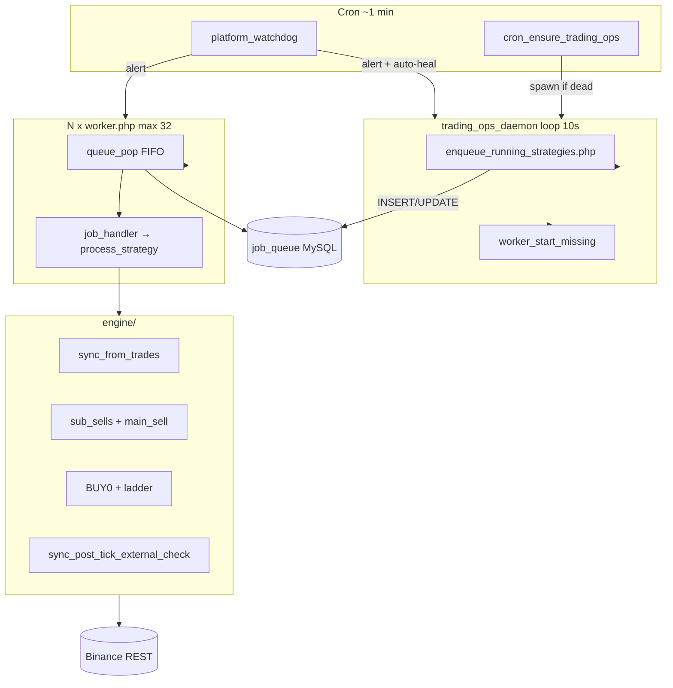
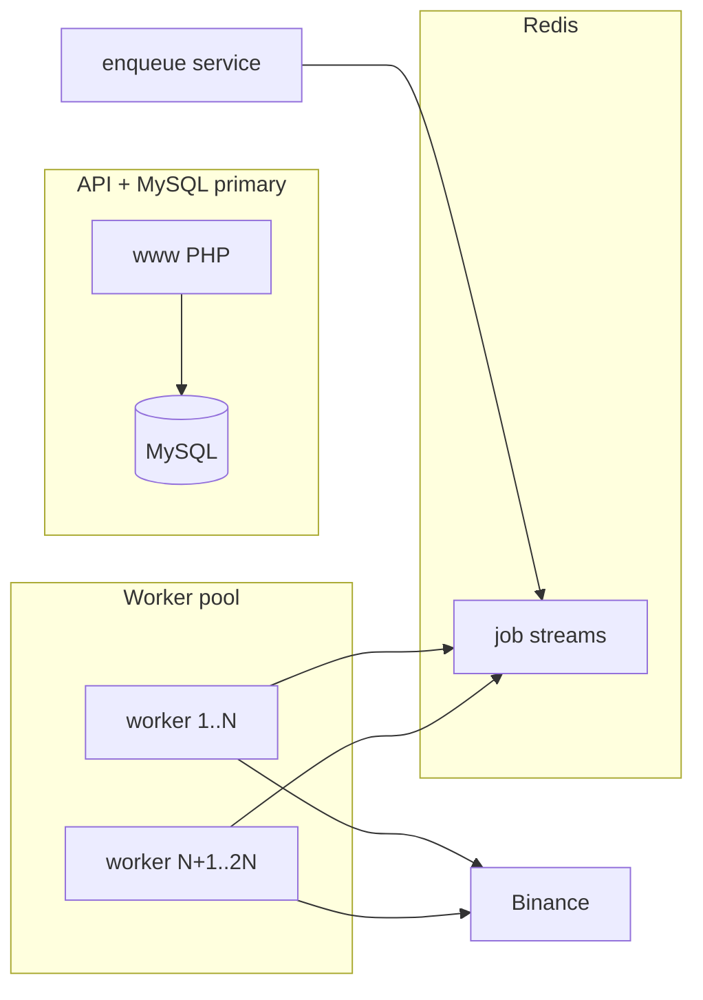

# StrIM — план масштабування платформи

**Версія:** 1.0  
**Дата:** 2026-05-19  
**Статус:** робочий документ (архітектура + етапи впровадження)

Цей файл описує, **як система працює зараз**, **де вузькі місця**, і **що робити по етапах** до ~50, ~300 і ~2000 одночасно активних стратегій.  
Доповнює `PROJECT_CONTEXT.md` (історія) і `NEW_CHAT_HANDOFF.md` (операційний handoff).

**Кінцева ціль (lag ціни ≤1 с, RoyalQ-модель):** окремий план **`docs/ARCHITECTURE_V2_EVENT_DRIVEN.md`** + rollout **`run/V2_ROLLOUT_GATE.md`**. Етапи 0–3 нижче — міст для V1; V2 впроваджується паралельно (strangler), не замінює цей файл одним днем.

---

## 1. Мета та принципи

### 1.1. Мета продукту при масштабуванні

| Пріоритет | Що означає |
|-----------|------------|
| **Надійність** | Кожна paying-стратегія отримує тік у передбачуваний час; немає «тихих» годин через daemon/чергу |
| **Справедливість** | Один користувач з 10 парами не блокує інших у глобальній FIFO-черзі |
| **Прозорість** | UI показує: останній тік, наступна докупка, TP — користувач розуміє «чому бот мовчить» |
| **Економіка** | Масштабування кроками — без передчасного Redis/K8s, поки не досягнуто ліміту етапу |

### 1.2. Що НЕ є метою зараз

- Гарантія прибутку або HFT-латентність (<1 с)
- 2000 **одночасно running** на одному shared VPS без зміни архітектури
- Заміна Binance REST на повний WebSocket за один спринт

### 1.3. Ключові метрики (SLO)

| Метрика | Етап 1 (зараз→50) | Етап 2 (→300) | Етап 3 (→2000) |
|---------|-------------------|---------------|----------------|
| **Tick lag p95** (running) | ≤ 30 с | ≤ 45 с | ≤ 90 с |
| **Tick lag max** (будь-яка running) | ≤ 120 с | ≤ 180 с | ≤ 240 с |
| **Engine alive** (global MAX last_tick) | ≤ 120 с | ≤ 120 с | ≤ 120 с |
| **Queue depth** `queued` | ≤ 50 | ≤ 200 | ≤ 500 (з autoscale) |
| **Uptime daemon** | 99.5% | 99.9% | 99.9% |

*Watchdog:* `run/platform_watchdog.php` + cron — Telegram при порушенні (див. §8).

---

## 2. Архітектура сьогодні (baseline)



### 2.1. Компоненти

| Компонент | Файл / шлях | Роль |
|-----------|-------------|------|
| **Supervisor** | `run/trading_ops_daemon.php` | Singleton (flock), кожні `TRADING_OPS_INTERVAL_SEC` (10 с) |
| **Enqueue** | `engine_v2/enqueue_running_strategies.php` | Скан `strategies` status running/paused, `queue_push` |
| **Workers** | `engine_v2/worker.php` × N | `queue_pop` → `handle_job` → `process_strategy` |
| **Черга** | `job_queue` (MySQL) | 1 рядок на (user_id, strategy_id, symbol); статуси queued/processing/done |
| **Логіка** | `engine/engine_logic.php` | Повний тік: sync, sell, BUY0, ladder |
| **Налаштування** | `app_settings` | `worker_target_count` (1–32), `worker_auto_enabled` |
| **Watchdog** | `run/platform_watchdog.php` | Lag, daemon, workers, stale jobs → Telegram |

### 2.2. Параметри за замовчуванням (прод)

| Параметр | Значення | Діапазон |
|----------|----------|----------|
| `TRADING_OPS_INTERVAL_SEC` | 10 | 3–300 |
| `worker_target_count` | 4 | 1–32 |
| `WORKER_STALE_LOCK_SEC` | 120 | ≥30 |
| `WORKER_IDLE_SLEEP` | 2 с | — |
| Enqueue batch | 500 | keyset по `strategies.id` |
| Тік `process_strategy` | ~2–5 с (типово) | до ~30+ с при retry sync |

### 2.3. Що вже виправлено (2026-05, критично для масштабу)

1. **Stale flock** — `worker_trading_ops_break_stale_lock()`, cron ensure, restart script  
2. **TEMPLATE у черзі** — не enqueue; `running` перед `paused` у `queue_pop`; cleanup script + адмін-кнопка  
3. **BUY0 після MAIN SELL** — reload position; post-tick sync  
4. **Watchdog** — dedup, per-strategy stale >240 с, auto-heal daemon/workers  
5. **SYNC_EXTERNAL false positive** — перевірка після тіку, не на початку  
6. **UI** — `engine.tick_lag_sec`, підказки L1/TP у `dashboard_saas.html`

---

## 3. Модель навантаження

### 3.1. Визначення

- **Користувач (user)** — акаунт у `users`
- **Стратегія (strategy)** — одна пара `symbol` у `strategies`
- **Активна стратегія** — `status IN ('running', 'paused')` (enqueue обидва; торгова логіка — обидва, на паузі без нових BUY)
- **Тік** — один `PROCESS_STRATEGY` job ≈ один виклик `process_strategy`

### 3.2. Навантаження на тік (Binance REST, орієнтовно)

| Сценарій | HTTP / тік |
|----------|------------|
| Idle (ціна OK, без угод) | ~3 (time, myTrades, ticker) |
| З retry sync | до ~32 |
| BUY / SELL | +3–6 (account, exchangeInfo, order) |

**Немає** глобального rate limiter по API key — ризик при багатьох стратегіях на одному ключі.

### 3.3. Пропускна здатність (один VPS, 4 workers)

```
Час повного циклу по S стратегіях ≈ S × T / W
T ≈ 3 с (середній тік), W = 4 workers

S=5   → ~4 с
S=50  → ~37 с
S=200 → ~150 с (~2.5 хв) для хвоста черги
```

Enqueue кожні 10 с додає нові jobs для стратегій, у яких попередній job уже `done` → при S>50 черга **не встигає стікатися**, якщо W мале.

### 3.4. Реалістичні сценарії бізнесу

| Сценарій | Running стратегій | Поточна готовність |
|----------|-------------------|-------------------|
| Старт / beta | 5–15 | ✅ OK (після фіксів infra) |
| Перші платні | 20–50 | ✅ Етап 1 ops на проді (2026-05-19): 10 workers, interval 5 с |
| Маркетинг | 100–300 | ❌ Етап 2 (next_tick_at, API cache) |
| Масовий SaaS | 500–2000 | ❌ Етап 3 (черга Redis, кілька хостів) |

**Важливо:** 2000 **зареєстрованих** ≠ 2000 **running**. Рекомендується лімітувати **одночасні running** тарифом (див. §7).

---

## 4. Вузькі місця (пріоритет)

| # | Вузьке місце | Симптом | Етап вирішення |
|---|--------------|---------|----------------|
| 1 | Глобальна FIFO-черга | Останні sid тікають рідко | 1b (пріоритет running), 2a (next_tick_at) |
| 2 | Enqueue O(N) кожні 10 с | DB load, paused/TEMPLATE сміття | ✅ частково; 2a |
| 3 | Фіксовані 4 workers | Черга росте | 1a (8–16 workers) |
| 4 | `sync_from_trades` кожен тік | Latency + Binance weight | 2b |
| 5 | Немає per-user fair queue | 1 user × 20 пар блокує інших | 2c |
| 6 | Single MySQL `FOR UPDATE` | Contention при W>16 | 3 |
| 7 | Binance rate limits (IP + key) | 429, бани | 2b, 3 |
| 8 | Shared hosting PHP | Немає Redis, обмежений CPU | 3 (VPS/dedicated) |
| 9 | Billing не паузить engine | Expired user still running | 1c (окремий таск) |

---

## 5. Етапи впровадження

### Етап 0 — стабільність (зроблено / підтримувати)

**Ціль:** 1–20 running, без «зависань» на години.

- [x] `trading_ops_daemon` + stale lock recovery  
- [x] `platform_watchdog` + cron (див. `run/cron_admtools.txt`)  
- [x] TEMPLATE не в черзі; cleanup `run/cleanup_template_queue_jobs.php`  
- [x] UI: tick lag, next buy, TP hints  
- [x] **Cron на проді (2026-05-19):** `cron_ensure` + `platform_watchdog` + `cron_billing_pause_expired` (див. `run/cron_admtools.txt`)

**Моніторинг:** `GET /api/health.php` → `engine_alive`, `job_queue.queued`.

---

### Етап 1 — до ~50 активних стратегій (1–2 тижні, мінімум коду)

**Ціль:** tick lag p95 ≤ 30 с, без зміни хостингу.

| # | Задача | Деталі |
|---|--------|--------|
| 1a | **Workers 8–16** | `app_settings.worker_target_count` через адмінку; спостерігати CPU RAM на bot20 — **ops** |
| 1b | **Enqueue interval 5 с** | `TRADING_OPS_INTERVAL_SEC=5` у `.env` — **ops** |
| 1c | **Billing → engine** | ✅ `www/api/_billing_access.php`, `strategy_set` start guard, `cron_billing_pause_expired.php`, enqueue + billing JOIN |
| 1d | **Alert queued > 100** | ✅ `platform_watchdog` + `health.php` job_queue.pressure |
| 1e | **Не enqueue paused** | ✅ enqueue лише `running` + active billing |
| 1f | **Документація для support** | «Бот мовчить» = lag, L1, USDT, pause (див. §1f нижче) |

**Очікуваний результат:** 50 running × 3с / 12 workers ≈ **12.5 с** на повний цикл.

---

### Етап 2 — до ~300 активних (1–2 місяці, зміни в коді)

**Ціль:** передбачуваний тік, менше Binance, fair queue.

#### 2a. `next_tick_at` per strategy

```sql
ALTER TABLE strategies
  ADD COLUMN next_tick_at DATETIME NULL DEFAULT NULL,
  ADD INDEX idx_strategies_due (status, next_tick_at, id);
```

- Enqueue: `WHERE status='running' AND (next_tick_at IS NULL OR next_tick_at <= NOW())`  
- Після тіку: `next_tick_at = NOW() + INTERVAL X SECOND` (X = 10 за замовч., або per-tariff)  
- **Ефект:** не сканувати 3000 рядків кожні 10 с; лише «due» стратегії

#### 2b. Кеш Binance (per user + symbol)

| Дані | TTL | Де |
|------|-----|-----|
| `myTrades` | 2–5 с | `app_settings` або file cache в `logs/cache/` |
| `account` (free USDT) | 5–10 с | перед BUY0 / ladder |
| `ticker/price` | WS cache вже є (`_ws_price.php`) | розширити |

- Повний `sync_from_trades` — кожні 30–60 с або після угоди  
- Легкий тік — лише price + open orders check

#### 2c. Fair queue

- Max **2 concurrent jobs** на `user_id` (перевірка в `queue_pop` або окрема черга per user)  
- Або пріоритет: `ORDER BY (status='running') DESC, user_id, id`

#### 2d. Легкий vs повний тік

| Тип | Частота | Дії |
|-----|---------|-----|
| **light** | кожні 10 с | price, TP/CB check, ladder triggers |
| **full** | кожні 60 с або після trade | sync_from_trades, adopt |

#### 2e. Індекси БД

- Застосувати `engine_v2/scaling_indexes.sql` на проді (якщо ще ні)  
- Індекс `job_queue (status, available_at, id)` — перевірити EXPLAIN

---

### Етап 3 — до ~2000 активних (3–6 місяців, інфраструктура)

**Ціль:** горизонтальне масштабування, autoscale workers.

| # | Компонент | Рішення |
|---|-----------|---------|
| 3a | **Черга** | Redis (lists/streams) або RabbitMQ; MySQL лишається для audit |
| 3b | **Workers** | 2+ VPS worker-only; autoscale по `queued` depth |
| 3c | **Binance** | User data stream WebSocket; batch prices; coordinator rate limit |
| 3d | **DB** | Read replica для dashboard; primary для queue writes |
| 3e | **Sharding** | `queue_shard = user_id % K` — K воркер-процесів на шард |
| 3f | **Deploy** | CI/CD, blue-green для `engine/` без зупинки daemon |



---

## 6. Тарифи та продуктові обмеження (рекомендація)

Щоб технічне масштабування збігалося з монетизацією:

| Тариф | Max running стратегій | Min tick interval | Пріоритет черги |
|-------|----------------------|-------------------|-----------------|
| Trial | 1 | 15 с | normal |
| Base (500 грн) | 1–2 | 10 с | normal |
| Pro | 5 | 10 с | high |
| Business | 15+ | 5 с | high |

Реалізація: поля в `users` або `subscriptions` → перевірка в `strategy_start.php` + `next_tick_at` interval.

---

## 7. Binance API — ліміти та політика

- **Weight** — агрегувати запити; не викликати `bn_server_time()` на кожен signed request окремо (оптимізація: кеш time 1 с)  
- **IP limit** — один outbound IP на bot20; при 2000 strats розглянути другий IP / проксі (обережно з ToS)  
- **Per API key** — кілька стратегій на одного user = один key → послідовність угод на ключі OK, паралельні workers на **різних** users — OK

**Політика помилок 429:** exponential backoff на worker, `queue_mark_failed` delay 60 с, watchdog alert.

---

## 8. Спостережність (observability)

### 8.1. Вже є

| Інструмент | Що показує |
|------------|------------|
| `health.php` | `engine_alive`, `lag_seconds`, `job_queue` |
| `platform_watchdog.php` | Telegram: daemon, lag, stale sid, workers |
| `admin_workers.php` | Workers, queue by strategy, TEMPLATE cleanup |
| `engine_journal` | Угоди, SKIP, помилки |
| `logs/trading_ops_daemon.log` | enqueue counts |

### 8.2. Додати на етапі 1–2

- [ ] Grafana / простий dashboard з `health.php` poll  
- [ ] Метрика `tick_lag_p95` per day (SQL aggregate з `strategies.last_tick_at`)  
- [ ] Alert `queued > 200` (watchdog)  
- [ ] Логування тривалості `process_strategy` в `app_settings` heartbeat per sid  

### 8.3. Env watchdog

```env
WATCHDOG_TICK_WARN_SEC=90
WATCHDOG_TICK_CRIT_SEC=180
WATCHDOG_STRATEGY_STALE_SEC=240
WATCHDOG_ALERT_COOLDOWN_SEC=900
WATCHDOG_AUTO_HEAL=1
```

---

## 9. Ризики та антипатерни

| Ризик | Мітігація |
|-------|-----------|
| Маркетинг до готовності етапу 2 | Ліміт running у тарифі; waitlist |
| Зростання без моніторингу | Watchdog + health обов’язкові в cron |
| «Зоопарк» paused/TEMPLATE стратегій | Не створювати TEMPLATE у prod; cleanup cron weekly |
| Ручна торгівля на Binance | SYNC_EXTERNAL лише після тіку + untracked orderId check |
| Один VPS SPOF | Етап 3 — другий worker host |
| Регуляторика / платежі | WhitePay + LiqPay окремо від engine scale |

---

## 10. Чеклист «готовність до N користувачів»

### Перед рекламою (20–50 paying)

- [x] Cron: `cron_ensure` + `platform_watchdog` + `billing_pause`  
- [x] Workers ≥ 8, interval 5 с (`TRADING_OPS_INTERVAL_SEC=5`, target 10)  
- [x] `health.php` engine_alive стабільно true (перевірка 2026-05-19)  
- [ ] Тарифний ліміт running стратегій у продукті  
- [x] Support / dev: пауза — `USER_PAUSE` + `status=paused` (`_strategy_status.php`, 2026-06-17)  
- [ ] Support знає: lag / L1 / USDT / різниця пауза vs «бот мовчить»  

### Перед масштабною рекламою (100+)

- [ ] Етап 2a `next_tick_at` на проді  
- [ ] Етап 2b cache Binance  
- [ ] Load test: 100 fake strategies / staging  
- [ ] queued alert + runbook  

### Перед 500+ running

- [ ] Redis queue POC  
- [ ] Другий worker server  
- [ ] Rate limit coordinator  

---

## 11. Файли для наступних змін (карта)

| Етап | Файли |
|------|--------|
| 1 | `.env`, `www/api/admin_workers.php`, `run/cron_admtools.txt` |
| 2a | `engine_v2/enqueue_running_strategies.php`, migration SQL, `strategies` |
| 2b | `engine/engine_helpers.php`, `engine_v2/job_handler.php` |
| 2c | `engine_v2/queue_pop.php` |
| 2d | `engine/engine_logic.php` (split light/full) |
| 3 | новий `engine_v3/queue_redis.php`, worker supervisor systemd |

---

## 12. Підсумок одним реченням

**Зараз** платформа розрахована на **~15–30 running стратегій** комфортно (після infra-фіксів); **до 50** — tuning workers + interval; **до 300+** — потрібні `next_tick_at`, кеш API і fair queue; **до 2000** — окрема черга (Redis) і кілька worker-хостів.

Оновлювати цей документ після кожного етапу впровадження (дата + checklist).

---

*Пов’язано: `NEW_CHAT_HANDOFF.md`, `PROJECT_CONTEXT.md` §13, `engine_v2/scaling_indexes.sql`, `run/cron_admtools.txt`.*

**Етап 3 (500+, Redis, multi-VPS, без урізання стратегій):** `docs/STAGE3_500_REDIS_MULTIHOST.md`
